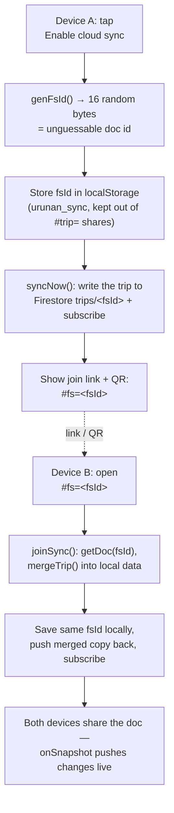

# Urunan 🧾
### _Split your bills_

Urunan is a bill-splitting app for trips and group activities: create a trip,
invite participants, record who paid what, and see who owes whom. Settle the
trip when everyone is square.

**Live app: https://rezpaditya.github.io/Urunan/**

The entire app is a single self-contained file — [`urunan.html`](urunan.html).
No server, no build step, no dependencies: Vue 3 and a QR code generator are
inlined, styling is hand-written CSS, and all data lives in your browser's
localStorage. Cross-device cloud sync is **optional** — point the app at a free
[Firebase](https://firebase.google.com/) project and trips you opt in are
mirrored to Cloud Firestore; leave it unconfigured and the app stays fully
local.

## Using the app

- **On your phone:** open the live URL in Safari/Chrome, then *Share → Add to
  Home Screen* to get a full-screen app icon. The app shows a one-time hint for
  this on the trips screen. On iOS the installed app starts with empty storage —
  log in with the same email and tap **Restore synced trips** to bring them over
  ([email restore](#recovering-synced-trips-on-a-new-device)).
- **Offline / no hosting:** download `urunan.html` and open it in any browser.
  Everything works from a `file://` URL too.

### Features

- Trips with multiple participants
- Transactions with custom payment splits (defaults to an even split,
  adjustable per person, validated against the total)
- Automatic debt settlement summary — minimal set of "who pays whom"
- Share a trip between devices with a **link or QR code** — no server
  involved: the trip data travels inside the URL fragment and merges
  automatically on import (repeat imports never duplicate data)
- **Optional live cloud sync** — enable it on a trip and changes flow both ways
  automatically across your devices through your own Cloud Firestore database
  (see [`FIREBASE_SETUP.md`](FIREBASE_SETUP.md)). Off until you add a Firebase
  config; the app is fully usable without it.
- **One-tap email restore** — restore every synced trip on a brand-new device
  (e.g. a freshly installed home-screen app that started with empty storage) by
  logging in with the same email and tapping **Restore**. See
  [Recovering synced trips](#recovering-synced-trips-on-a-new-device).
- Works offline; data persists in localStorage per device

## Optional: cross-device cloud sync (Cloud Firestore)

Sync is **off until you add a Firebase config** — `FIREBASE_CONFIG` (near the
top of `urunan.html`) ships blank, so forks and offline/`file://` loads work
untouched and all sync UI stays hidden. Fill it in with a free Firebase project
and opted-in trips are mirrored to **Cloud Firestore**, syncing live across
every device that opens the trip's link.

**Setup is a few clicks in the Firebase console — see
[`FIREBASE_SETUP.md`](FIREBASE_SETUP.md)** for the exact steps (create a
project, enable Anonymous Auth + Firestore, paste the web config, publish the
security rules). The web config is **not a secret**: it's meant to ship in
client code, and access is governed by the Firestore security rules, not by
hiding it.

Offline-first is preserved: `localStorage` stays the working store, so the app
loads and edits with no network and from a `file://` URL. Firestore is layered
on top — the Firebase SDK is fetched from the CDN only when a config is present,
so a blank config or a blocked/offline load simply leaves sync unavailable.

## How cloud sync works

Sync is **per trip**. Enabling it on a trip mints an unguessable Firestore
document id (a capability — whoever holds the `#fs=<id>` link can read/write
that one trip) and mirrors the trip there. Other devices open the link, merge
the trip in, and subscribe for live updates. Every device signs in with
**Anonymous Auth** so the security rules can require an authenticated caller.
Everything below happens inside `urunan.html` (search for the
`Cloud sync (Cloud Firestore)` block).

### Starting sync — how a trip is shared and joined



- **How it starts:** enabling sync mints a random **document id** (16 random
  bytes, base64url) kept in a separate `urunan_sync` localStorage entry so it
  never leaks into `#trip=` link shares. The join link is `…/#fs=<id>`.
- **How a device joins:** opening the `#fs=` link (or scanning its QR) makes the
  app read `trips/<id>`, merge it locally, store the same id, push its merged
  copy back, and subscribe. Repeat imports never duplicate data.

### What triggers a sync

Local writes push to Firestore; peers' writes arrive live via `onSnapshot`. A
push (`syncNow`) fires on:

| Trigger | When |
|---|---|
| App launch | `syncAllOnStartup()` subscribes + refreshes every synced trip |
| Opening a synced trip | `openTrip()` calls `syncNow` immediately |
| A local edit | `maybeSync()` — **debounced 1.5 s** after add/edit/delete of a transaction, member changes, or settling |
| Tab/app regains focus | `visibilitychange` re-syncs the open trip |
| A peer's change | `onSnapshot` delivers it and merges it in — no action needed |
| Manual **🔄 Sync now** button | on demand |

There is **no polling loop**; `onSnapshot` is push-based, and a re-entrancy
guard means only one push per trip runs at a time.

### The sync cycle — merge-on-write, converge-on-snapshot

```mermaid
sequenceDiagram
    participant A as Device A
    participant F as Cloud Firestore<br/>trips/&lt;fsId&gt;
    participant B as Device B

    Note over A: local edit → wait 1.5 s (debounce)
    A->>F: runTransaction: read doc
    F-->>A: current trip (or empty)
    Note over A: mergeTrip() (union users & transactions,<br/>newer updated_at wins, apply tombstones)
    A->>F: write merged trip back
    F-->>B: onSnapshot delivers the new doc
    Note over B: mergeTrip() into local data
    B->>F: (on its own edits) merge + write back
    F-->>A: onSnapshot delivers B's changes
    Note over A,B: both converge — no duplicates
```

**Merging** (`mergeTrip`) is what makes two-way sync safe: users and
transactions are unioned by id, an edited transaction wins by its `updated_at`
timestamp, and deletions carry **tombstones** (`deleted_tx_ids`,
`deleted_user_emails`) so a delete on one device is never resurrected by an
older copy. Pushes run in a Firestore **transaction** (read → merge → write) so
two devices writing at once converge instead of clobbering each other;
`mergeTrip` is idempotent, so a transaction retry is safe.

### What Firestore stores

Unlike the old relay, Firestore is a real database: each synced trip is stored
as a document `trips/<fsId>` holding the trip JSON (`tripJson`) plus an
`updatedAt`. Google hosts this data in your project — it is **not** end-to-end
encrypted (that's the trade-off for a durable, queryable store). Access is
limited by the [security rules](FIREBASE_SETUP.md): an authenticated caller who
knows the document id. Deleting an entire **trip** is local-only and does not
propagate (deleting a single transaction does, via tombstones); turning off
sync on a device just stops mirroring — other devices keep their copy.

### Recovering synced trips on a new device

Sync creds (the trip's `fsId`) live in each device's `localStorage`. A
brand-new device therefore doesn't know them — most visibly when you **Add
Urunan to your Home Screen on iOS**, where the installed web app gets its own
storage partition and starts empty. The join link/QR is one way back;
**email restore** is the simpler one.

- **How it works:** whenever you enable or join sync, the app writes an
  "index" document — `inbox/<hash(email)>` — that lists every synced trip's
  `fsId`. Any active device keeps it fresh. No setup, no passphrase.
- **Restoring:** on the new device, log in with the **same email**, then tap
  **🔄 Restore synced trips** (also offered in the empty state and the
  Add-to-Home-Screen hint). The app reads the index for your email and re-joins
  every trip. One tap, done.
- **Privacy trade-off:** the index document id is derived from your **email
  alone**, which is not secret, so anyone who knows your email could read your
  synced trips' ids (and thus those trips) from Firestore. This is a deliberate
  choice for one-tap restore; trips you haven't synced are never listed. If you
  need synced data kept off that index, share the `#fs=` join link/QR by hand
  instead of relying on email restore.

## Development

Edit `urunan.html`, open it in a browser, refresh. That's the whole loop.

## Deployment

Pushing a change to `urunan.html` on `main` triggers the
[`github-pages`](.github/workflows/github-pages.yml) workflow, which copies it
to the `gh-pages` branch as `index.html`; GitHub Pages publishes from there.
Manual alternative: commit the file to `gh-pages` yourself.

## Archived

The original implementation — a Vue 3 + Vite SPA with a FastAPI/SQLAlchemy
backend, Auth0 authentication, and Docker-based deployment — lives in
[`archived/`](archived/) for reference. It is no longer deployed or maintained.
